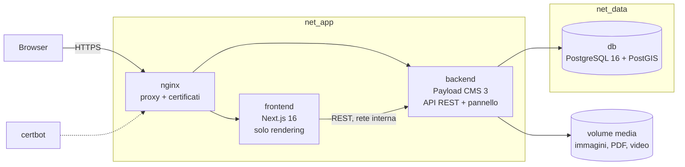

# Architettura

## Obiettivo

Sito vetrina della terapia Sorazon e della rete dei centri, con un CMS usabile da persone non tecniche. È la **fase 1** di una piattaforma a fasi (formazione con Moodle, portale/CRM dei centri in Python, community): ogni fase aggiunge servizi accanto a questi, con lo stesso schema.

## Servizi

Tre container indipendenti, più i servizi di supporto:

| Servizio | Immagine / sorgente | Ruolo | Reti |
|---|---|---|---|
| `db` | `postgis/postgis:16-3.4` | Dati del CMS. PostGIS serve al campo `point` dei Centri | `net_data` |
| `migrate` | `backend/` (stadio `build`) | Job che applica le migrazioni a ogni avvio, poi esce | `net_data` |
| `backend` | `backend/` (stadio `run`) | Payload 3.91 dentro un'app Next.js minimale: API REST e pannello `/admin` | `net_data`, `net_app` |
| `frontend` | `frontend/` | Next.js 16 / React 19: disegna le pagine leggendo il backend via REST | `net_app` |
| `nginx` + `certbot` | profilo `proxy` | HTTPS, intestazioni di sicurezza, limiti di frequenza, certificati Let's Encrypt | `net_app` |
| `seed` | profilo `strumenti` | Contenuti di partenza nello stack | entrambe |

**Il frontend non può raggiungere il database**: non è sulla rete `net_data`. Si verifica con `docker compose exec frontend nc -zv db 5432`, che deve fallire. Il frontend non importa mai la configurazione di Payload: usa il pacchetto `payload` solo per i **tipi** e per convertire il rich text.

## Flusso dei dati

1. Il visitatore chiede una pagina al **frontend**.
2. Il frontend la costruisce leggendo il backend con `fetch` (`frontend/src/lib/api.ts`, `lib/content.ts`) sulla rete interna (`PAYLOAD_INTERNAL_URL`, nello stack `http://backend:3000`). Le richieste sono **anonime**: vedono solo il pubblicato.
3. Le risposte restano in cache con dei **tag** (`pages`, `posts`, `globals`, `centri`, `redirects`, `pages-sitemap`, `posts-sitemap`).
4. Quando un contenuto cambia, un hook del backend (`hooks/notifyFrontend.ts`) chiama `POST {FRONTEND_INTERNAL_URL}/api/revalidate` con l'header `x-revalidate-secret`; il frontend invalida i tag (`revalidateTag(tag, { expire: 0 })`) e la pagina successiva è aggiornata.

Le pagine non si pre-generano in build (`generateStaticParams` restituisce `[]`): **`next build` e `docker build` non hanno bisogno né del backend né del database**. Una sola immagine per ambiente: gli indirizzi si leggono **a runtime** (mai `NEXT_PUBLIC_*`).

## Anteprima delle bozze

- Il pannello apre `{FRONTEND_PUBLIC_URL}/next/preview?path=…&previewSecret=…`; la rotta attiva il `draftMode` di Next.
- In anteprima il frontend legge le bozze da `GET /api/<pages|posts>/anteprima/:slug` (`backend/src/endpoints/anteprima.ts`) con l'header `x-internal-secret` = `REVALIDATE_SECRET`. Il frontend non ha credenziali del CMS.
- Anteprima dal vivo nel pannello: `components/PreviewBar` con `RefreshRouteOnSave`.

## Immagini e moduli

Il browser non conosce l'indirizzo del backend. Il frontend riscrive (`next.config.ts`):

- `/media/:path*` → `{backend}/api/media/file/:path*` (la funzione `mediaSrc()` converte gli URL);
- `/api/form-submissions` → backend (invio dei moduli).

I file caricati stanno nel volume `media` (`MEDIA_DIR=/data/media`). In sviluppo senza Docker stanno in `backend/public/media`.

## Email

Adattatore nodemailer attivo solo se c'è `SMTP_HOST`. In sviluppo c'è **Mailpit** (`make db`, casella su http://localhost:8025).

- `EMAIL_FROM` (`it@sonotronitalia.com`): email di sistema (password, account).
- `EMAIL_INFO` (`info@sonotronitalia.com`): destinatario e mittente predefiniti dei moduli del sito.

## Servizi futuri

Stesso schema: un container per servizio, rete interna, database proprio. In programma: Moodle (formazione), Keycloak o Authentik (accesso unico quando i servizi riservati saranno almeno due), servizi Python (FastAPI) per il portale dei centri con AI, visualizzatore 3D del dispositivo (React Three Fiber). Dettagli nella sezione 9 di [CLAUDE.md](../../CLAUDE.md).
